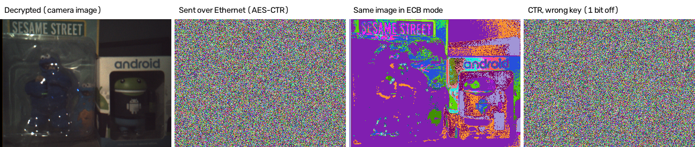
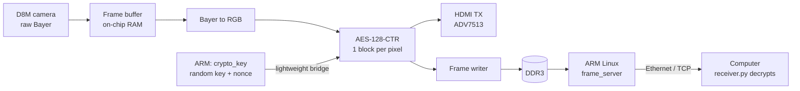
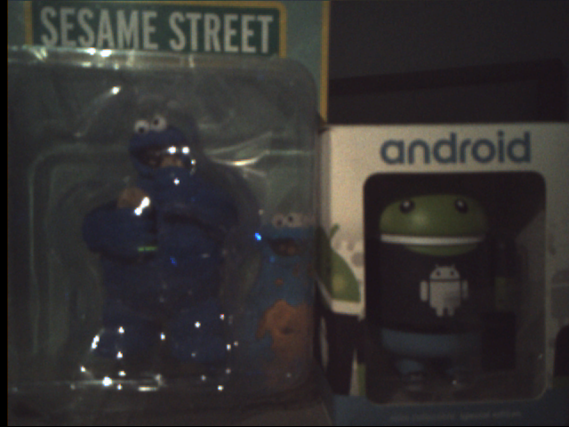
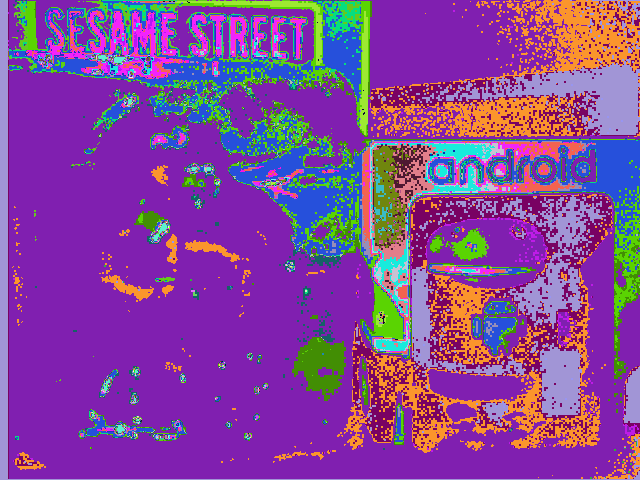

# FPGA hardware image encryption

Real-time **AES-128 encryption of a live camera stream, in FPGA hardware**, on a
Terasic **DE10-Nano** (Intel Cyclone V SoC: FPGA + dual-core ARM) with a
**D8M-GPIO** camera. Every pixel is encrypted as it leaves the camera pipeline,
at full video rate (640x480 @ 60 Hz), with no frame buffering in software.

The encrypted video goes two ways: to the board's **HDMI** output, and over
**Ethernet** to a computer that holds the key and decrypts it. The key is created
by the ARM processor and loaded into the FPGA; it never travels over the network.

Final project for the *Systems on Chip* course at Insper.

*Left to right: decrypted image on the computer · what travels over the cable
(AES-CTR) · the same image in ECB mode (outlines leak) · decryption with a wrong key.*

## How it works

- **Encryption:** AES-128 in counter (CTR) mode. Pixel *n* of frame *f* is
  `RGB XOR AES(key, nonce ‖ f ‖ n)[0:3]`. The AES core is fully pipelined: one
  128-bit block per clock at the 25 MHz pixel clock, 11 cycles of latency.
- **Key management:** `crypto_key` on the ARM draws a random key and nonce from
  `/dev/urandom` and writes them into a register block in the FPGA. The FPGA
  restarts its frame counter, so no keystream is ever reused.
- **Streaming:** on request, the FPGA writes one frame of ciphertext straight
  into the ARM's DDR3 memory. `frame_server` sends it over TCP; `receiver.py`
  rebuilds the keystream and shows the decrypted video.
- **Demo modes (board switches):** plain image, CTR ciphertext, ECB view,
  on-board decryption, decryption with a wrong key, all on the HDMI output.

Details: [architecture](docs/architecture.md) · [encryption](docs/encryption.md) ·
[setup and running the demo](docs/hardware-setup.md) ·
[problems found and how they were solved](docs/debugging.md)

## Why the ECB image matters

The third panel of the demo image shows the same frame encrypted in **ECB mode**
(Electronic Codebook) instead of CTR. It uses the same AES-128 and the same key,
and the scene is still recognisable:

| Camera image | ECB mode | CTR mode (used) |
|---|---|---|
|  |  |  |

- **ECB encrypts each block on its own:** `cipher = AES(key, pixel colour)`. The
  same colour always gives the same ciphertext, so every area of one colour turns
  into an area of one (random) colour. Edges, text and shapes survive: "SESAME
  STREET", "android" and both figures can still be read.
- **CTR encrypts a counter, not the pixel:** `cipher = pixel XOR AES(key, nonce ‖ frame ‖ pixel index)`.
  The counter is different for every pixel of every frame, so two identical pixels
  never give the same ciphertext and the result is uniform noise.
- **The cipher is the same; the mode makes the difference.** AES itself is secure
  in both panels; ECB leaks the *structure* of the data. This is the classic
  "ECB penguin" effect, reproduced here on live video.

On the board, SW1 switches the HDMI output to this ECB view. The FPGA reduces
each colour to 3 bits per channel before encrypting, so similar colours map to the
same ciphertext and the effect is easy to see. Only 24 of the 128 output bits are
shown, so this view is for comparison only and cannot be decrypted. The ECB image
in the repository is computed on the computer by `capture_demo.py` with the same
function as the FPGA (`fpga/rtl/video_crypt.v`, `ecb_block`). See
[encryption](docs/encryption.md) for details.

## Results

| | |
|---|---|
| Video | 640x480 @ 60 Hz, 24-bit RGB, encrypted pixel by pixel |
| AES throughput | 25 M blocks/s (one per pixel clock), fully pipelined |
| FPGA usage | 19,856 / 41,910 ALMs (47 %), 470 / 553 RAM blocks (85 %), 2 DSP |
| Timing | met on all clocks (Quartus 25.1, slow 100 °C model) |
| Verification | 5 testbenches checked against pycryptodome: 0 errors |

## Repository layout

| Path | Contents |
|---|---|
| [`fpga/`](fpga) | Quartus project: top level, Platform Designer system (`soc_system.qsys`), constraints |
| [`fpga/rtl/`](fpga/rtl) | **Our design**: AES-128 pipeline, video encryption, frame buffer, frame writer (FPGA to DDR3) |
| [`fpga/ip/crypto_regs/`](fpga/ip/crypto_regs) | **Our** Platform Designer component: key, nonce and frame-grab registers |
| [`fpga/terasic/`](fpga/terasic) | Third-party: Terasic demo modules for the camera, HDMI and video timing (see its README) |
| [`fpga/sim/`](fpga/sim) | Testbenches and Python reference models (`run_all.sh`) |
| [`software/board/`](software/board) | ARM programs (`crypto_key`, `frame_server`), boot script, Linux setup |
| [`software/host/`](software/host) | Computer side: `receiver.py` decrypts and shows the stream |
| [`prebuilt/`](prebuilt) | Ready-to-use bitstreams and the Quartus project archive |
| [`docs/`](docs) | Documentation and images |

## Quick start

**Without Quartus** (board, camera and SD card only), see
[setup](docs/hardware-setup.md) for each step:

1. Write Terasic's DE10-Nano Linux Console image to a microSD card, then copy
   `prebuilt/soc_system.rbf` and `software/board/boot/u-boot.scr` to its FAT partition.
2. Plug the D8M camera into GPIO 1 (JP7), an HDMI monitor, and an Ethernet cable to the computer.
3. On the board: `make` in `software/board`, then `./crypto_key` and `./frame_server`.
4. On the computer: `pip install -r software/host/requirements.txt`, then
   `python receiver.py 192.168.10.2 --key <key> --nonce <nonce>`.

**To build the FPGA design:** open `prebuilt/DE10_NANO_CRYPTO.qar` in Quartus Prime
25.1 Lite (*Project → Restore Archived Project*) and compile, or run
`fpga/scripts/build.sh`, which also regenerates the Platform Designer system and
writes `soc_system.rbf`.

**To run the simulations:** `fpga/sim/run_all.sh` (needs Icarus Verilog and pycryptodome).

## Development steps

1. **Fixed key, FPGA only:** camera → AES-128-CTR → HDMI, key built into the design, switches for the demo modes.
2. **Key from the ARM:** Platform Designer system (Terasic GHRD + `crypto_regs`), `crypto_key` writes the key through the lightweight HPS-to-FPGA bridge.
3. **Encrypted stream over Ethernet:** FPGA-to-SDRAM frame writer, `frame_server` on Linux, `receiver.py` on the computer.
4. **Debugging on hardware:** camera sampling, line stride, memory port resets, FIFO alignment and Bayer phase. See [debugging](docs/debugging.md).

## Hardware

- Terasic DE10-Nano (Cyclone V SoC 5CSEBA6U23I7), rev. C
- Terasic D8M-GPIO camera (OV8865 sensor + TC358748 MIPI-to-parallel bridge)
- HDMI monitor, microSD card, Ethernet cable (direct link to the computer)
