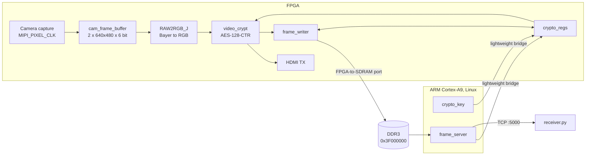

# Architecture

## Overview

## Video path (FPGA)

| Block | File | What it does |
|---|---|---|
| Camera capture | `fpga/rtl/DE10_NANO_CRYPTO.v` | Samples the 10-bit raw pixels from the D8M on the **falling** edge of its pixel clock, in the I/O registers |
| Camera configuration | `fpga/terasic/d8m/MIPI_BRIDGE_CAMERA_Config.v` | Configures the OV8865 sensor and the TC358748 bridge over I2C (640x480 output) |
| Frame buffer | `fpga/rtl/cam_frame_buffer.v` | Two banks of 640x480 raw pixels in on-chip M10K RAM (6 bits each, to fit). The camera writes one bank while the display reads the other, so frames never tear |
| Bayer to RGB | `fpga/terasic/d8m/RAW2RGB_J.v` | Rebuilds R, G, B from the Bayer mosaic using a 2-line buffer. Its phase (`iPHASE`) is set by the ARM through the GHRD `led_pio` (see [debugging](debugging.md)) |
| Video timing | `fpga/terasic/vga/VGA_Controller.v` | 640x480 @ 60 Hz timing (25 MHz pixel clock) |
| Encryption | `fpga/rtl/video_crypt.v` | AES-128-CTR, ECB view and on-board decryption, see [encryption](encryption.md) |
| HDMI | `fpga/terasic/hdmi/I2C_HDMI_Config.v` | Configures the ADV7513 transmitter over I2C; the FPGA drives it with 24-bit parallel RGB + sync |
| Frame writer | `fpga/rtl/frame_writer.v` | On request, packs one frame of ciphertext (32 pixels = three 256-bit words) into an async FIFO and writes it to DDR3 |

## ARM-FPGA interface

The ARM reaches the FPGA through the **lightweight HPS-to-FPGA bridge** at
`0xFF200000`. The Platform Designer system (`fpga/soc_system.qsys`) is Terasic's
DE10-Nano GHRD plus our `crypto_regs` component.

| Address | Block | Use |
|---|---|---|
| `0xFF206000` | `crypto_regs` | Key, nonce, commit, frame grab, status (register map in `fpga/ip/crypto_regs/crypto_regs.v`) |
| `0xFF203000` | GHRD `led_pio` | Bits 1:0: Bayer phase (reset value gives the correct colours) |
| `0x3F000000` | DDR3 | Frame buffer for the stream, 921,600 bytes. Linux is booted with `mem=1008M` so it never uses this area |
| `0xFFC25080` | SDRAM controller `fpgaportrst` | FPGA-to-SDRAM port resets, released (`0x1FF`) at boot and by `frame_server` |

The frame writer uses the **FPGA-to-SDRAM** port (`f2h_sdram0`, 256-bit Avalon-MM)
to write into DDR3 without involving the CPU. One grab:

1. `frame_server` writes the buffer address and sets `GRAB`.
2. `frame_writer` empties its FIFO, waits for the next vertical sync and captures one whole frame.
3. The memory side writes 28,800 words of 32 bytes; `STATUS.done` rises with the frame number used by AES.
4. `frame_server` copies the frame from `/dev/mem` and sends it with a small header (size, frame number, flags).

## Clock domains

| Clock | Frequency | Used by |
|---|---|---|
| `MIPI_PIXEL_CLK` (inverted) | 25 MHz | Camera capture, frame buffer write side |
| `vga_clk` (PLL) | 25 MHz | Frame buffer read side, Bayer to RGB, AES, HDMI, frame writer video side |
| `FPGA_CLK1_50` | 50 MHz | Platform Designer system, `crypto_regs`, frame writer memory side |
| `FPGA_CLK2_50` | 50 MHz | Camera and HDMI I2C configuration, reset |

Crossings: the frame buffer hands banks over with toggle handshakes, key changes
reach the video clock through `toggle_sync`, and ciphertext reaches the memory
clock through `async_fifo` (Gray-coded pointers).

## Resource usage

Quartus Prime 25.1 Lite, 5CSEBA6U23I7:

| Resource | Used |
|---|---|
| Logic (ALMs) | 19,856 / 41,910 (47 %) |
| Registers | 11,983 |
| Block memory bits | 3,766,841 / 5,662,720 (67 %) |
| RAM blocks (M10K) | 470 / 553 (85 %) |
| DSP blocks | 2 / 112 |
| PLLs | 1 / 6 |

Two AES-128 pipelines (transmitter and on-board receiver) account for most of the
logic: each has 10 rounds x 16 S-boxes. The frame buffer accounts for most of the
RAM: 2 x 640 x 480 x 6 bits = 3.7 Mbit.
